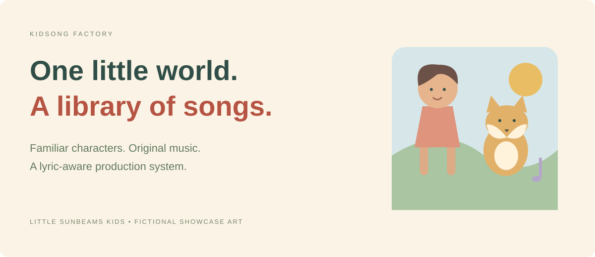

# Kidsong Factory

### One little world. A whole library of songs.

A character-aware music-video pipeline built around **Little Sunbeams Kids**. Generated music, reusable reference art and a lyric-aware storyboard turn an educational brief into a finished sing-along package.

Python 3.12 · uv · Suno adapter · Ideogram · fal / LTX · FFmpeg · FastAPI.

[Explore the interactive showcase](https://1zoz1.github.io/kidsong-factory/) · [The production system](#the-production-system) · [Local operating guide](#local-operating-guide) · [Why customization matters](#why-customization-matters)



> Public documentation and interactive showcase of an existing local application. Runtime source and production data are not distributed here. The page uses fictional characters, lyrics and timings.

## The production system

The implemented sequence builds visuals first so a scene's look can be reviewed before the song and final composition:

```text
Ideate → Scenes → Animate → Thumbnail → Song → Align
       → Storyboard → Assemble → Metadata → QA
```

| Component | What the code does |
|---|---|
| Brief and lyrics | An Anthropic adapter creates the teaching concept, lyrics, roster, scene descriptions, shot list and metadata. A built-in sample brief is available when the API key is absent. |
| Character references | One reference PNG per named character is stored under `assets/characters/<channel>/<name>.png` and reused across scenes. References can be replaced with your own artwork. |
| Scene images | Ideogram, fal or Gemini adapters condition scenes on reference artwork. The Ideogram adapter passes only the primary character reference. |
| Gentle motion | fal image-to-video supports model-family payloads including LTX. A configured limit controls how many scenes receive generated motion. The remaining scenes use local Ken Burns motion; fal errors also fall back to it. |
| Music | A Suno adapter through sunoapi.org or an ElevenLabs Music adapter creates the audio. These require separate configured provider access. |
| Lyric alignment | Suno forced alignment is used when available. Otherwise line timings use even spacing and storyboard cuts fall back to proportional shot weights. |
| Storyboard | Real lyric timings choose scenes by overlap with the shot-list lyrics; the actual song duration drives the plan. |
| Final package | FFmpeg creates a 1920 × 1080 MP4 with a time-aligned lyric overlay; a local thumbnail and `metadata.json` accompany it. |
| QA | Checks cover the render, song/video duration agreement, thumbnail and scene presence, with a low-shot-count warning. |

**Lyric-synced** means real alignment was available for that job. Fallback jobs use proportional cuts.

Each job has persistent state. `kidsong resume` skips completed stages and continues an interrupted run; it does not automatically rebuild dependent steps when the brief, artwork or settings change.

## Local operating guide

The following commands operate an existing local application working copy. This public repository contains the showcase and documentation, not the runtime.

### 1. Set up

Use Python **3.12**, uv, and FFmpeg/ffprobe with subtitle support. The application prefers bundled executables under `tools/ffmpeg/bin/` and otherwise searches PATH. Windows font paths in `.env.example` should be changed for other systems.

```powershell
uv sync
Copy-Item .env.example .env
uv run kidsong channels
```

For provider-backed generation, configure your own credentials and select the appropriate `MUSIC_PROVIDER`, `IMAGE_PROVIDER` and `VIDEO_PROVIDER`. LTX is selected through `FAL_VIDEO_MODEL`; the model is configurable. `MAX_ANIMATED` or a channel's `max_animated_scenes` limits paid motion generation.

### 2. Review in stages

```powershell
uv run kidsong make <channel-id> --until scenes
uv run kidsong resume <video-id> --until storyboard
uv run kidsong resume <video-id>
uv run kidsong dash --host 127.0.0.1 --port 8848
```

The local dashboard opens at `http://127.0.0.1:8848`. Publishing is a separate action after production.

### 3. Use placeholders deliberately

Set `DRY_RUN=true` for placeholder music/images and local motion. **This flag is not a universal no-network switch:** the current ideation step still calls Anthropic when `ANTHROPIC_API_KEY` is set. For an isolated placeholder run, clear that key from both the environment and `.env`, and use a separate sample channel, character-reference directory and job. Existing reference images are reused.

### Publishing and additional formats

The runtime includes explicit YouTube publishing, playlist organization, compilation, vertical Shorts and autopilot commands. These may upload or schedule content; they are not invoked by the static showcase. The `publish` command defaults to private, and kids-song metadata sets `made_for_kids=true`.

## Why customization matters

[Shorts Factory](https://1zoz1.github.io/shorts-factory/) demonstrates a general narration-first vertical format. Kidsong Factory is a separate, specialized implementation of the same staged production idea:

| General short-form video | A recurring sing-along world |
|---|---|
| Channel niche and narrator persona | Teaching goal, cast and brand voice |
| Independent stock clips or AI stills | Reference-conditioned characters and reusable scenes |
| Narration determines the timeline | Song duration and available lyric alignment determine cuts |
| Word-highlighted speech captions | Time-aligned song lyrics |
| Vertical final video | Landscape song, with separate Shorts/compilation tools |

The brand is **Little Sunbeams Kids**. The showcase uses an original fictional cast, **Pip and Sunny**, rather than exposing any private production character asset. A color-song interaction demonstrates the timing concept without claiming to play generated audio.

## Scope and limits

Reference conditioning guides identity; secondary characters can still vary, especially with the Ideogram adapter's single primary reference. Watch the finished video for continuity, pronunciation, educational value and scene/lyric correspondence. Structural QA and the made-for-kids flag support the process; they do not replace audience, rights and platform review.

Provider access and supported model IDs depend on your accounts. Local cost estimates are not provider invoices. The current manifest does not declare the Google API/OAuth client packages used by YouTube publishing. Growth, monetization, learning outcomes and autonomous editorial approval are not promised.

## Public package

`docs/` is a self-contained, responsive static site with original SVG artwork and a small interactive timing demonstration. There is no backend, telemetry, provider request or production data. Open `docs/index.html` directly or serve `docs/` with a static server. Publish `main:/docs` through GitHub Pages.

Production `.env`, secrets, channel profiles, character assets, media, statistics and revenue are excluded from the public package.
